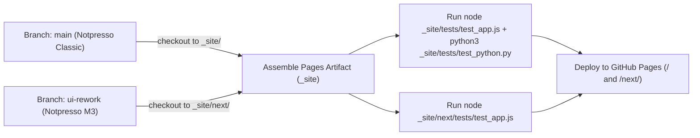

# 06 — Material Design 3 UI Rework & Dual-Deployment Proposal

> **Status:** Locked architectural & UX specification (`ui-rework` blueprint, finalized via `/grill-me`). **Phase 0 has not started yet** — no branches, app source files, or CI workflows have been modified.

---

## Executive Summary

Deploying a `ui-rework` branch into `/next/` alongside `main` in GitHub Pages allows installing and testing a Material Design 3 (**Notpresso M3**) overhaul side-by-side with Classic (**Notpresso**) on real hardware without risking daily espresso pulls.

However, migrating to **Material Design 3** cannot be solved by swapping CSS colors in [`styles.css`](../styles.css):
- **DOM & Script Coupling:** [`index.html`](../index.html) (`1,081` lines) contains `97` lines with inline `style="..."` attributes and `74` emoji occurrences (`28` unique glyphs). [`app.js`](../app.js) (`3,961` lines) mutates `177` distinct `el.*` DOM properties directly inside business logic, rebuilds UI fragments across `9` `.innerHTML` sites, and mixes `42` emoji occurrences (`11` unique glyphs) inside formatters and renderers.
- **Layout Rigidness:** [`styles.css`](../styles.css) (`1,821` lines) has `0` `@media` queries, locks `.app-container` to `max-width: 480px`, and relies on rigid stacks/grids (such as `.vis-front-row`'s `1fr 1fr 1fr 64px` and `.recipe-info-col` / `.home-fav-info` `min-width: 150px`) that squeeze poorly on compact cover/Flex viewports and leave wide screens unused.
- **M3 Structural Shift:** M3 replaces top horizontal text tabs, heavy slate boxes, permanent multi-row telemetry cards above tabs, and drop-shadows with **tonal surface elevation**, **Bottom `NavigationBar` / Side `NavigationRail`**, **Segmented Buttons**, **Modal Bottom Sheets**, **semantic Top App Bar fault tinting**, **vector SVG iconography**, and **adaptive Light + Dark schemes**.

**Core Recommendation:** Keep Notpresso's zero-build, zero-CDN offline PWA DNA. On `ui-rework`, separate [`app.js`](../app.js) into a UI-free BLE/protocol/state core plus lightweight native ES-module views, backed by semantic `--md-sys-*` CSS tokens (`Auto / Dark / Light`) and a self-contained SVG symbol sprite (`Monochrome` vs `Chromatic` A/B toggle).

---

## Finalized Design Decisions

| Area | Locked Specification |
| :--- | :--- |
| **1. Navigation Destinations (`4`)** | **`Brew`**, **`Craft`**, **`Saved`**, **`Machine`** — `NavigationBar` (`< 600px`) / `NavigationRail` (`>= 600px`). |
| **2. `Brew` Vertical Order** | Keep **`6` Presets** first (instant ad-hoc tweaking), followed by **`My Favorites & Suggestions`**. Move Hardware Scheduled Timer out of `Brew`. |
| **3. Unified `Craft` Vertical Flow** | Scrollable single page separating brewing from maintenance cleanly: **(1) Craft Custom Recipe** (2-Stage Builder) → **(2) Pre-Infusion Bloom** (`Espresso Bloom` / `Lungo Bloom` + soak lab) → **(3) Cleaning Capsules** (dedicated maintenance soak card). |
| **4. Top App Bar & Universal Fault Signalling** | Fold **`Logs`** into a **`3s` long-press (`LOGO_HOLD_REFRESH_SEC`) on the `Settings` button** (removing dedicated debug icon). Move technical telemetry chips (`#telemetryRow`) once connected to the top of **`Machine`**. Replace subtitle (`#envSubtitle`) across **all tabs** with concise connection/alert summary, and tint the **`Notpresso` Title** dynamically: Neutral (disconnected), Connected (healthy), **Orange/Amber** (`Descaling Needed`, `Slider Open`, `Stock Low`), **Red/Error** (`Water Tank Empty`, `Capsule Tray Full`, `Hardware Fault`). |
| **5. `Machine` Tab Order** | Top-to-bottom: **(1) Live Technical Connection & Telemetry Card** (expanded alerts & chips) → **(2) Hardware Scheduled Brew Timer** → **(3) Diagnostics, Capsule Stock & Auto-Off/Hardness** → **(4) Physical Rotary Dial Cup Sizes** → **(5) Interactive Descaling Guide**. |
| **6. Appearance Settings (Theme & Icon A/B)** | Inside Settings (`Appearance`), expose two live persisted toggles:<br>• **Color Theme:** **`Auto (System)`** default via `prefers-color-scheme` (`Light` & `Dark` both styled out-of-the-box) with **`Dark` / `Light`** manual override.<br>• **Icon Theme (Live A/B):** Toggle between **`Monochrome M3`** vs **`Tinted Stages & Thermal`** for real-world side-by-side comparison. |
| **7. Separate PWA Identity & Phase 0 Safety** | Deploy at `/next/`, manifest `"short_name": "Notpresso M3"`, `"name": "Notpresso M3"`, `"id": "./next/"`, `"orientation": "any"`, distinct home-screen SVG badge. Include **Phase 0 cache-scoping safety patch on `main`** (`sw.js` + `forceAppCacheUpdate()`) so Classic never wipes `/next/` caches. |
| **8. Z Flip5 Cover & Flex Mode Policy** | Never lock tabs out on ultra-short viewports (`~360×374px` Cover Screen / `~412×430px` Flex Mode): keep all `4` tabs usable with compact `48dp` TopBar, `52dp` Bottom Nav, `2×2` simulator stack, `min-width: 0` rows, and full-screen modal sheets. |

---

## 1. Dual-Deployment & Branching Architecture (`main` vs `/next/`)

### 1.1 GitHub Pages Build Topology

Currently, [`.github/workflows/pages.yml`](../.github/workflows/pages.yml) triggers on `push` to `main`, executes `node tests/test_app.js` and `python3 tests/test_python.py`, and uploads `path: '.'` via `actions/upload-pages-artifact@v3`.



**Workflow setup for Phase 0:**
1. Trigger [`.github/workflows/pages.yml`](../.github/workflows/pages.yml) on `push: branches: [main, ui-rework]` (and `workflow_dispatch`).
2. Assemble staging directory `_site/`:
   - Checkout `main` into `_site/`.
   - Checkout `ui-rework` into `_site/next/`.
3. Execute both test suites (`_site/tests/` and `_site/next/tests/test_app.js`) before `upload-pages-artifact@v3` uploads `_site` so broken M3 commits never overwrite live GitHub Pages.
4. Keep every asset link in `ui-rework` strictly relative (`./`) so `/next/` resolves cleanly. Sync protocol/recipe fixes from `main` → `ui-rework` on demand via standard branch merges.

### 1.2 Service Worker & Cache Isolation (Includes Phase 0 Fix on `main`)

> [!WARNING]
> Both `/` (**Notpresso**) and `/next/` (**Notpresso M3**) share the **same browser origin** (`https://<user>.github.io`). Without scoped pruning on **both** branches, triggering a 3-second force refresh or Service Worker update in Classic deletes `/next/`'s offline cache and SW registration.

Two current implementations require scoping fixes before `/next/` launches:
1. **[`sw.js`](../sw.js#L1-L28):** Currently sets `CACHE_NAME = notpresso-v${SW_VERSION}` and deletes **every** cache key where `key !== CACHE_NAME`.
2. **[`app.js` (`forceAppCacheUpdate`)](../app.js#L3875-L3888):** Calls `navigator.serviceWorker.getRegistrations()` (unregistering **all** SWs on the origin) and `caches.keys()` (deleting **all** caches on the origin).

**Concrete Isolation Rules (applied to `main` & `ui-rework` in Phase 0):**
- **Cache Prefix Separation:**
  - `main` (`Classic`): uses `notpresso-v${SW_VERSION}`; `sw.js` `activate` deletes keys where `!key.startsWith('notpresso-next-') && key !== CACHE_NAME` (preserving any `/next/` cache untouched).
  - `ui-rework` (`M3`): uses `notpresso-next-v${SW_VERSION}`; `sw.js` `activate` deletes only keys where `key.startsWith('notpresso-next-') && key !== CACHE_NAME`.
- **Scoped Force-Update Gesture (`3s` Logo Hold):**
  - On `main`: filter `getRegistrations()` to registrations matching Classic scope (not ending with `/next/`) and delete only `!key.startsWith('notpresso-next-')` caches (keeping existing [`tests/test_app.js`](../tests/test_app.js#L1028-L1084) assertions green, plus adding a negative test asserting `notpresso-next-v*` survives!).
  - On `ui-rework`: filter `getRegistrations()` to `r.scope === new URL('./', window.location.href).href` and delete only `key.startsWith('notpresso-next-')` caches.
- **Same-Origin Shared State Benefit:** Because `/` and `/next/` share the same origin, Web Bluetooth permissions and `localStorage` (`notpresso_auth_key`, `notpresso_saved_recipes_v3`) remain shared seamlessly — zero re-pairing and full recipe sync between Classic and M3!
  - *Invariant:* Store M3-specific settings (`auto/dark/light` theme, `mono/tinted` icon theme) in a dedicated key (`notpresso_m3_prefs`) and keep any recipe metadata strictly additive so toggling back to Classic never corrupts saved recipes.

### 1.3 Separate PWA Manifest & On-the-Fly Switching

- **[`manifest.json`](../manifest.json) on `ui-rework` (`/next/manifest.json`):**
  - `"id": "./next/"` and `"start_url": "./index.html"` — gives Chrome/Android a distinct WebAPK package alongside Classic.
  - `"name": "Notpresso M3"` and `"short_name": "Notpresso M3"` — clearly identified in the Android app drawer and home screen for usage tracking and instant side-by-side bug comparison.
  - `"orientation": "any"` — replaces `"portrait"` (line 6) so landscape phones, tablets, and unfolded foldables rotate freely.
  - **Distinct App Icon Badge:** Modify the inline SVG icon with an explicit `M3` / stylized corner accent so Classic and **Notpresso M3** icons are unmistakable on your home screen.
- **In-App Cross-Links:**
  - Classic Settings adds a quick link (`./next/` — *Open Notpresso M3*).
  - **Notpresso M3** Settings displays `M3 Preview` metadata plus a one-tap *Switch to Classic UI* link (`../`).

---

## 2. Theme vs. Under-the-Hood Architecture

### 2.1 Why "Native ES Modules + M3 Tokens (Zero Build)" Wins

| Approach | Pros | Cons | Verdict |
| :--- | :--- | :--- | :--- |
| **Pure CSS Override (`styles.css` only)** | Zero JS edits | Blocked by `97` inline `style=` lines, `42` JS emojis, cramped 5-tab `<nav>`, and `177` direct `el.*` couplings; M3 sheets/rails break | **Rejected** |
| **React/Preact + MUI + Vite** | Stock component kit | Adds `node_modules`, bundler build step, bundle overhead; breaks Node VM test runner pattern | **Rejected** |
| **CDN `@material/web` + Google Fonts** | Official Google Web Components | Heavy runtime + network-fetched CSS/WOFF2 dependencies risk offline PWA caching | **Rejected** |
| **Native ES Modules + M3 CSS Tokens + Tiny UI Core** | **Zero build, offline-first, Node-testable core, clean separation of BLE vs M3 views** | Requires modularizing [`app.js`](../app.js) on `ui-rework` | **Recommended** |

### 2.2 Proposed Module Split (`ui-rework`)

Splitting [`app.js`](../app.js) (`3,961` lines) cleanly isolates machine hardware correctness from Material 3 experimentation:

```text
my-notpresso/ (on ui-rework)
├── index.html               # Semantic M3 App Shell (TopBar, 4-Tab NavBar/Rail, 4 Views, Sheets/Dialogs)
├── manifest.json            # Distinct id "./next/", name "Notpresso M3", orientation "any", badged SVG icon
├── sw.js                    # Prefixed notpresso-next-v* cache + complete offline precache manifest
├── styles/
│   ├── tokens.css           # M3 HCT Auto (Light & Dark) surface/color/shape/type/motion tokens
│   ├── components.css       # TopBar, NavBar/Rail, Cards, Segmented Buttons, Sliders, Sheets, Dialogs
│   └── responsive.css       # Cover/Flex-Short, Compact, Medium (Rail + 2-col), Expanded (2-pane) rules
└── src/
    ├── core/
    │   ├── protocol.js      # PURE JS (No DOM): BLE UUIDs, PairingKey, payload builders, bitfield parsers, presets
    │   ├── store.js         # Reactive state + localStorage (v3 recipes + notpresso_m3_prefs) + pub/sub
    │   └── ble.js           # Web Bluetooth connect/read/write/notify wired cleanly to store actions
    └── ui/
        ├── icons.js         # Self-contained Material Outlined SVG sprite + icon() helper (Mono vs Tinted CSS support)
        ├── shell.js         # TopAppBar (Title color + dynamic alert subtitle), 3s Logo/Settings holds, 4-tab Nav, Theme & Icon A/B sync, Snackbar
        ├── views/
        │   ├── brew.js      # 6 Expandable Presets first -> My Favorites & Suggestions below
        │   ├── craft.js     # Scrollable cards: (1) Craft Custom Recipe -> (2) Pre-Infusion Bloom -> (3) Cleaning Capsules
        │   ├── saved.js     # Favorites & Library + Pointer Drag Reorder + Rename Dialog
        │   └── machine.js   # (1) Live Tech Telemetry -> (2) Scheduled Timer -> (3) Diagnostics/Stock/Hardness -> (4) Dial Sizes -> (5) Descale Guide
        └── modals.js        # Active Brew Sheet, Settings Sheet (Auth + Theme + Icon A/B + Switcher), Logs Sheet (via Settings 3s hold), Full-Screen Manual, Factory Reset Confirm Dialog
```

### 2.3 Adaptive M3 Dark + Light Color System (`tokens.css`)

Material 3 uses semantic `--md-sys-color-*` tokens derived from a **Warm Espresso / Crema Gold** seed (`#C88D4B`), replacing opaque box borders and black drop-shadows (`--shadow-card`) with **tonal surface steps** plus semantic **Top App Bar fault tokens**:

| M3 Token Role | Dark Scheme (`prefers-color-scheme: dark` / `[data-theme="dark"]`) | Light Scheme (`prefers-color-scheme: light` / `[data-theme="light"]`) | Usage |
| :--- | :--- | :--- | :--- |
| `--md-sys-color-surface` | `#161310` (Tone 6 warm espresso) | `#FFF8F3` (warm porcelain) | App background canvas & dynamic `<meta name="theme-color">` |
| `--md-sys-color-surface-container-lowest` | `#110E0B` (Tone 4) | `#FFFFFF` | Log console, sunken inputs, simulator inset |
| `--md-sys-color-surface-container-low` | `#1E1B17` (Tone 10) | `#FAF2EA` | Standard cards (`Presets`, `Diagnostics`) |
| `--md-sys-color-surface-container` | `#231F1B` (Tone 12) | `#F4ECE4` | `NavigationBar`, `NavigationRail`, stage subcards |
| `--md-sys-color-surface-container-high` | `#2D2924` (Tone 17) | `#EFE6DE` | Expanded preset cards, Modal Bottom Sheets |
| `--md-sys-color-surface-container-highest` | `#39342E` (Tone 22) | `#E9E0D8` | Dialogs, menus, active chips |
| `--md-sys-color-primary` / `-on-primary` | `#F0BC7D` (Tone 80) / `#452A06` (Tone 20) | `#82551E` (Tone 40) / `#FFFFFF` | Primary Brew/Save CTAs (`>= 4.5:1` AA contrast in both modes) |
| `--md-sys-color-primary-container` / `-on-...` | `#603F16` (Tone 30) / `#FFDEAD` (Tone 90) | `#FFDEAD` (Tone 90) / `#2B1700` | Selected Segmented Button, Active Navigation Indicator Pill |
| `--md-sys-color-tertiary` | `#9ECAFF` (Tone 80) | `#1B60A5` (Tone 40) | **Water** stage identity vs Crema **Coffee** |
| `--app-status-connected` | `#7DDA8C` | `#146C2E` | Healthy connected `Notpresso` title/status tint |
| `--app-status-warning` | `#FFB74D` | `#9A5B00` | Orange warning title/subtitle tint (`Descaling Needed`, `Slider Open`, `Stock Low`) |
| `--md-sys-color-error` / `-container` | `#FFB4AB` / `#93000A` | `#BA1A1A` / `#FFDAD6` | Red fault title/subtitle tint (`Tank Empty`, `Tray Full`, `Faults`), Stop Brew, Factory Reset confirm |
| `--md-sys-color-outline-variant` | `#4E453B` | `#D7C3B1` | Sparse card strokes (`1px`) and dividers |

- **Flash-Free Auto Default + Manual Override:** An inline script in `<head>` reads `localStorage.getItem('notpresso_m3_prefs')` (`theme: 'auto' | 'dark' | 'light'`) before stylesheet paint, applies `data-theme`, and syncs `<meta name="theme-color">` live on system/user changes.
- **State Layers & Motion:** Standard M3 `8%` hover / `12%` active/focus state-layer overlays over surface containers (`cubic-bezier(0.2, 0, 0, 1)`, `200ms–300ms`), `>= 48×48px` accessible hit targets, and `tabular-nums` alignment for volumes, countdowns, and GATT bytes.

---

## 3. UX Migration Map (Classic UI → Material 3)

| Current UI Area | Current Implementation | Target Material 3 Pattern & UX Improvement |
| :--- | :--- | :--- |
| **Top App Bar & Universal Telemetry** | [`.app-header`](../styles.css#L61-L66) + permanent [`.connection-card`](../index.html#L53-L95) (`3` right icons + subtitle + large status box above tabs) | **M3 Small Top App Bar (`64dp`, `48dp` on short screens):**<br>• **Left:** `btnLogoRefresh` (`3s` hold force-update + circular ring) + **`Notpresso` title (dynamically tinted by machine health: neutral / healthy green / orange warning / red error)** + `M3` badge.<br>• **Subtitle (`#envSubtitle`):** Static `"EN 350.G Offline BLE Controller"` when idle; replaced across **all tabs** by concise live status/alert summary when connected or faulted.<br>• **Right:** Compact **`Connect` Pill** + **`Manual`** button + **`Settings` button (short tap = Settings; hold `3s` = opens `BLE Packet Inspector / Logs`)**. Dedicated `btnLogs` icon removed cleanly! |
| **Technical Connection Details & Alerts** | `#telemetryRow` + `#ledTelematicsBanner` sitting permanently above navigation | Moved into **`Machine` Card #1** once connected so `Brew` starts cleanly at the top fold with zero wasted space (while urgent warnings/faults surface globally in the Top App Bar title + subtitle). Routine actions trigger a floating **Snackbar** above `NavigationBar`. |
| **Primary Navigation (`4` Destinations)** | `5` cramped horizontal text tabs ([`.nav-tabs`](../index.html#L98-L104)) including `"Library & Favorites"` | **Adaptive `NavigationBar` (`< 600px`) ↔ Left `NavigationRail` (`>= 600px`)** with **`4` balanced items**: **`Brew`**, **`Craft`**, **`Saved`**, **`Machine`**. |
| **`Brew` View** | `6` Presets → Favorites → Scheduled Timer | **`6` Expandable Presets** at top (fast ad-hoc tweaking) → **`My Favorites & Suggestions`** below. Scheduled Timer moved cleanly to **`Machine`**. |
| **`Craft` View** *(Custom + Bloom + Clean)* | Separate `#tab-custom` and `#tab-bloom` (mixing Bloom brewing with Cleaning maintenance) | Scrollable 3-card stack separating coffee craft from machine cleaning:<br>1. **Craft Custom Recipe** (2-stage volumetric builder + stage swap + split temps)<br>2. **Pre-Infusion Bloom** (`Espresso Bloom` / `Lungo Bloom` templates + soak lab)<br>3. **Cleaning Capsules** (dedicated maintenance soak card below Bloom). |
| **`Machine` View** | Diagnostics first, Dial second, Auto-Off/Hardness third, Descale fourth ([`Structural Contract`](../tests/test_app.js#L1009-L1016)) | Ordered top-to-bottom:<br>1. **Live Technical Telemetry Card** (Status chips + detailed LED/fault breakdown)<br>2. **Hardware Scheduled Brew Timer** (`3a32` read/set/cancel)<br>3. **Machine Diagnostics, Stock & Auto-Off / Hardness**<br>4. **Physical Rotary Dial Cup Sizes** (`Factory Defaults` vs `My App Calibration`)<br>5. **Interactive Descaling Guide & Simulator** (plus quick access to `Logs` if user prefers tapping). |
| **Temperature Controls** | 4 parallel CSS variants ([`.temp-btn` & `.temp-toggle-group.compact`](../styles.css#L343-L414)) | **Unified M3 Single-Select Segmented Button** (`Warm 80°` \| `Hot 85°` \| `Max 90°`) with active checkmark across all views. |
| **Settings, Theme, Icon A/B & Logs** | Centered boxes (`max-width: 440px` / `520px`) | **Adaptive Modal Bottom Sheet** (`28px` top radius, drag handle) on phones → **Side/Centered Sheet** on `>= 600px`. **Settings → Appearance** hosts **`Theme: Auto / Dark / Light`** and **`Icon Style: Monochrome M3 / Tinted`** plus **`Switch to Classic UI`**. Logs Sheet triggers via **`Settings` 3s hold** (with subtle hint inside Settings too). |
| **User Manual Modal** | `#manualModal` boxed at `56vh` ([L1710](../styles.css#L1710), [L1750](../styles.css#L1750)) | **M3 Full-Screen Dialog** on compact/short screens → spacious Dialog on tablet/desktop. |
| **Factory Reset Safety** | Single-tap `#btnBleFactoryReset` (`⚠️`) inside `#settingsModal` ([L897](../index.html#L897)) | **M3 Destructive Confirmation Dialog** (`error-container` `Cancel` / `Reset Machine`) before firing `03 07 00`. |

---

## 4. Iconography Strategy & Live A/B Settings Switch

### 4.1 Codebase Emoji Audit

- **[`index.html`](../index.html):** **`74` emoji occurrences (`28` unique glyphs)** (`📖 ⚙️ 📡 ⚡ 💧 ☕ ⏰ 💾 🔄 🧼 🌸 ⏱ ⏸ ➕ 🔍 🛑 🎛 🏭 📱 🔒 🌡 👉 👀 ✓ ✨ ⚠ 📄 🔧`).
- **[`app.js`](../app.js):** **`42` emoji occurrences (`11` unique glyphs)** rendered dynamically (`⏱ ☕ ✓ ✨ 💧 ✏ 🎛 🗑 ⚠ 🔒 ✗`).

### 4.2 Vector Replacement + Live `Monochrome` vs `Tinted` Toggle

Embed a single inline **SVG `<symbol>` sprite + `icon(name)` helper** (`Material Symbols Outlined` geometry, 24×24dp, `currentColor`, ~`4–6 KB`, zero external font CDN calls so offline PWA precaching remains 100% deterministic):

| Semantic Group | Classic Emojis | Target M3 Outlined Symbol |
| :--- | :--- | :--- |
| **Navigation (`4` Tabs)** | *(new)* | `local_cafe` (`Brew`), `sliders` (`Craft`), `bookmarks` (`Saved`), `memory` (`Machine`) |
| **Header & Actions** | `📖`, `⚙️`, `⚡` | `menu_book` (`Manual`), `settings` (`Settings` tap / `3s` hold for `Logs`), `bolt` (`Connect`) |
| **Coffee vs Water & Thermal** | `☕`, `💧`, `🌡` | `coffee`, `water_drop`, `thermostat` |
| **Actions & Workflows** | `➕`, `💾`, `🔄`, `✏️`, `🗑️`, `⏰`, `🧼`, `🌸`, `⏱`, `⏸`, `▶️`, `🛑` | `add`, `save`, `sync`, `edit`, `delete_outline`, `schedule`, `cleaning_services`, `eco`, `timer`, `pause`, `play_arrow`, `stop_circle` |
| **Hardware Telemetry** | `🔒`, `⚠`, `✓`, `✗`, `🔍`, `🏭`, `📱` | `lock` / `lock_open`, `warning_amber`, `check_circle`, `cancel`, `analytics`, `precision_manufacturing`, `smartphone` |

**In-App A/B Architecture (`data-icons="mono" | "tinted"` on `<html>`):**
- **`mono` (Monochrome M3):** Crisp Material outline strokes matching container ink tokens everywhere; only semantic alert icons (Orange Warning / Red Error) and primary stage badges (`Coffee` Crema vs `Water` Blue) carry accent color.
- **`tinted` (Chromatic Stages & Thermal):** Retains chromatic temperature indicators (`Warm` golden, `Hot` amber, `Max` coral) and stage/button tinting across cards & buttons for rapid visual scanning.
- Changing the toggle in **Settings → Appearance** swaps `data-icons` immediately with zero page reload so you can compare A/B over days in both Light and Dark mode.

---

## 5. Responsive Device Matrix (`Z Flip5` ↔ `S24 Ultra` ↔ Tablets/Desktop)

### 5.1 Current CSS Responsive Bottlenecks

- `0` `@media` queries across [`styles.css`](../styles.css); `.app-container` caps at `max-width: 480px`.
- [`.drink-grid`](../styles.css#L417-L421) stays single-column on wide displays.
- [`.recipe-info-col`](../styles.css#L739) and [`.home-fav-info`](../styles.css#L852) hardcode `min-width: 150px`, cramping narrow rows.
- [`.vis-front-row`](../styles.css#L1562) fixes `1fr 1fr 1fr 64px` (4 cramped columns in the Descale simulator).
- [`.manual-reader-pane`](../styles.css#L1710) and [`.manual-pdf-frame`](../styles.css#L1750) hardcode `56vh`.

### 5.2 Target Viewport Matrix & Breakpoints

| Device / Window State | Approximate CSS Viewport | M3 Size Class & Chrome | Key Layout Rules in `responsive.css` |
| :--- | :--- | :--- | :--- |
| **Galaxy Z Flip5 Cover Screen (Flex Window)** & **Narrow Zoom** | `~360 × 374 px` (near `1:1` with camera notch) or `344–360px` width | **Ultra-Compact / Short** (`max-width: 375px` and/or `max-height: 500px`) | 1. Shrink Top App Bar to `48dp`; keep all `4` Bottom Nav destinations accessible (`52dp` bar + `env(safe-area-inset-bottom)` clearance above cover camera cutout).<br>2. Set `min-width: 0` on recipe/favorite info rows.<br>3. Convert `.vis-front-row` (`1fr 1fr 1fr 64px`) → **`2 × 2` Grid** (`1fr 1fr`).<br>4. Force Modals/Manual/Logs to **100% Full-Screen Sheets** so dialogs remain readable. |
| **Galaxy Z Flip5 Flex Mode (Folded Half-Screen)** | `~412 × 400–450 px` (top pane) | **Compact + Short Height** (`max-height: 500px`) | 1. Compact `48dp` TopBar + `52dp` Bottom Nav + full-screen sheets.<br>2. *(Progressive Enhancement)* Optional `@media (vertical-viewport-segments: 2)` + `env(viewport-segment-*)` hook to place active brew status/simulator above the crease and controls below. |
| **Galaxy S24 Ultra** & **Z Flip5 Full Inner Portrait** | S24 Ultra: `~384 × 832 px` (`412px` alt)<br>Z Flip5 Inner: `~412 × 891–1004 px` (`22:9`) | **M3 Compact** (`< 600px` width) | 1. Primary phone layout: edge-to-edge (`16px` inline gutters), Top App Bar (`64dp`) + fixed **`80dp` 4-Tab `NavigationBar`** putting navigation cleanly in the lower thumb zone (key for tall `22:9` Z Flip5 screens!).<br>2. Modal Bottom Sheets (`Settings`, `Logs`, `Brew`). |
| **Landscape Phones** (`S24 Ultra`, `Z Flip5`) & **Portrait Tablets / Fold Inner** | `600px – 839px` width | **M3 Medium** (`@media (min-width: 600px)`) | 1. Requires `manifest.json` `"orientation": "any"`.<br>2. Swap Bottom Bar → **Left `NavigationRail` (`80px`)**, maximizing vertical space.<br>3. Upgrade `.drink-grid`, `.diag-grid`, `.dial-handshake-grid` to **2 balanced columns** (`repeat(2, minmax(0, 1fr))`).<br>4. Convert Bottom Sheets to side/centered sheets (`max-width: 560px`). |
| **Desktop / Unfolded Landscape Tablets** | `>= 840px` (`Large >= 1200px`) | **M3 Expanded** (`@media (min-width: 840px)`) | 1. Expand `.app-container` max width (`1120px`) beside persistent `NavigationRail`.<br>2. **2-Pane Master-Detail Layouts:** `Brew` (6 Presets grid left + `My Favorites & Suggestions` right), `Craft` (Custom Builder left + Bloom & Cleaning cards right), `Saved` (Library left + Live Recipe Preview right), `Machine` (Telemetry/Timer/Diagnostics left + Dial & Descale right). |

---

## 6. Verification & Phased Migration Plan

### 6.1 Keeping BLE Protocol Guarantees Intact

[`tests/test_app.js`](../tests/test_app.js) (`1,329` lines) protects machine command encoding and safety invariants:
- **Suite 1 (BLE Codecs & Builders) & Suite 2 (Bug-Fix Regressions):** Preserve every binary packet, bitfield, and pairing assertion unchanged by running `src/core/protocol.js` + `src/core/store.js` directly inside Node tests.
- **Suite 3 & `Structural Contract` ([L1009](../tests/test_app.js#L1009)):** Keep Classic tests untouched on `main` (adding only a positive prefix-isolation test for `notpresso-next-*` during Phase 0). On `ui-rework`, evolve `Structural Contract` for M3 invariants:
  - `4` Bottom Navigation destinations (`Brew`, `Craft`, `Saved`, `Machine`), `Brew` preset-first order, `Craft` stacked order (`Custom -> Bloom -> Cleaning`), `Machine` order (`Telemetry -> Scheduled Timer -> Diagnostics -> Dial -> Descale`).
  - Both `LOGO_HOLD_REFRESH_SEC` gestures intact (`btnLogoRefresh` -> cache purge; `btnSettings` hold -> open Logs Sheet).
  - Top App Bar dynamic title color classes (`connected` / `warning` / `error`) and subtitle override across active tabs.
  - `Auto / Dark / Light` theme persistence + `<meta name="theme-color">` update, `mono / tinted` icon A/B toggle, destructive confirmation guard around Factory Reset, zero inline HTML styles, and zero UI emojis.

### 6.2 Staged Roadmap (`ui-rework` Starts Only When Approved)

1. **Phase 0 — Branch, Dual-Deploy CI & `main` Cache Safety:**
   - Apply non-invasive SW & `forceAppCacheUpdate()` cache-prefix isolation (`!key.startsWith('notpresso-next-')`) + quick `./next/` link on `main` cleanly.
   - Branch `ui-rework`, wire dual `_site/` + `_site/next/` assembly in [`.github/workflows/pages.yml`](../.github/workflows/pages.yml), configure **Notpresso M3** `/next/manifest.json`, and verify both PWAs install and cache independently offline.
2. **Phase 1 — Headless Core Extraction (`ui-rework`):**
   - Extract `core/protocol.js`, `core/store.js`, `core/ble.js` while keeping legacy UI running cleanly and passing all Suite 1 & Suite 2 Node tests.
3. **Phase 2 — M3 Tokens (`Auto/Dark/Light`), Icon Sprite (`Mono/Tinted` A/B) & Responsive Shell:**
   - Implement `tokens.css`, `icons.js`, Top App Bar with dynamic status title/subtitle, Settings `3s` hold for Logs, `4`-item `NavigationBar`/`NavigationRail`, and Z Flip5 / S24 Ultra / Tablet responsive breakpoints.
4. **Phase 3 — View & Sheet Migration:**
   - Build semantic M3 views (`brew.js`, `craft.js`, `saved.js`, `machine.js`) + adaptive Sheets, Full-Screen Manual dialog, Destructive Factory Reset dialog, and eliminate all `97` inline `style=` attributes and `116` emoji sites.
5. **Phase 4 — Hardware Validation & Promotion:**
   - Install **Notpresso** (`/`) and **Notpresso M3** (`/next/`) side-by-side on S24 Ultra and Z Flip5 (Cover, Flex, Inner, Dark/Light, Mono/Tinted A/B). Once verified and preferred over time, merge `ui-rework` → `main` and retire `/next/` workflow steps cleanly.
